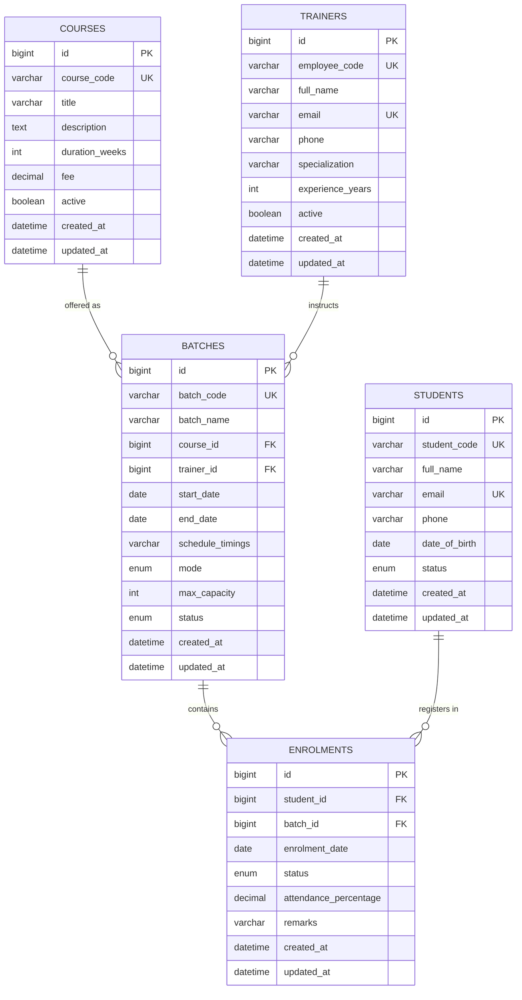

# Entity-Relationship Diagram

## Overview

The system uses five persistent InnoDB tables in `institute_db`: `courses`, `trainers`, `students`, `batches`, and `enrolments`.

## ER Diagram

## Key Constraints

- **Unique Business Keys:** `courses.course_code`, `trainers.employee_code`, `trainers.email`, `students.student_code`, `students.email`, `batches.batch_code`.
- **Composite Unique Key:** `enrolments(student_id, batch_id)` named `uk_student_batch` prevents duplicate enrolment of the same student in the same batch.
- **Referential Integrity:** All foreign keys use `ON DELETE RESTRICT ON UPDATE CASCADE` so parent records with dependent batches or enrolments cannot be removed silently.
- **Check Constraints:**
  - `courses.duration_weeks > 0` and `courses.fee >= 0.00`
  - `trainers.experience_years >= 0`
  - `batches.end_date >= batches.start_date` and `batches.max_capacity > 0`
  - `enrolments.attendance_percentage` between `0.00` and `100.00`
