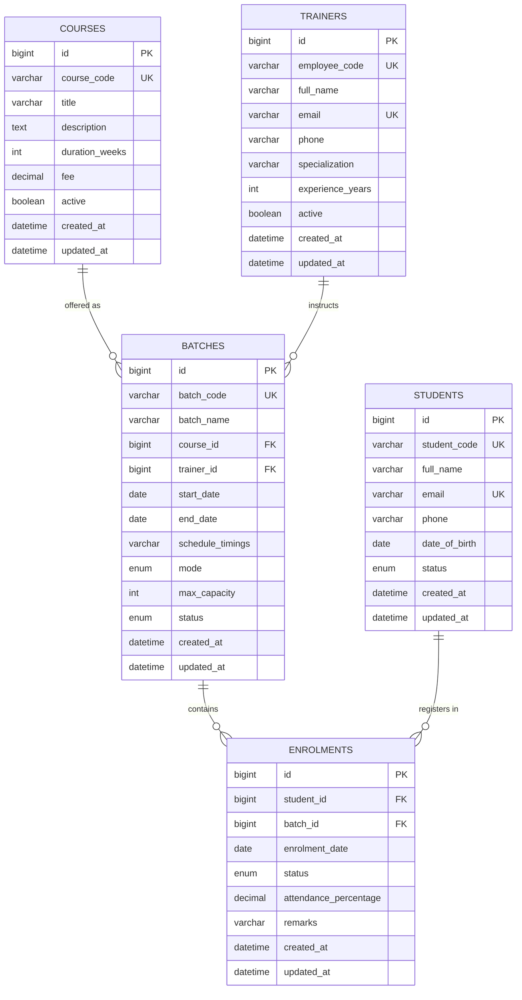

# Database Design

**Database Engine:** MySQL 8.x (InnoDB)  
**Database Name:** `institute_db`  
**Character Set / Collation:** `utf8mb4` / `utf8mb4_unicode_ci`  
**Schema Script:** `database/schema.sql`  
**Seed Data Script:** `database/sample-data.sql`

---

## 1. Entity-Relationship Diagram

---

## 2. Table Specifications

### 2.1 `courses`
| Column | Type | Constraints |
|---|---|---|
| `id` | `BIGINT` | `PRIMARY KEY`, `AUTO_INCREMENT` |
| `course_code` | `VARCHAR(20)` | `NOT NULL`, `UNIQUE (uk_courses_course_code)` |
| `title` | `VARCHAR(150)` | `NOT NULL` |
| `description` | `TEXT` | `NULL` |
| `duration_weeks` | `INT` | `NOT NULL`, `CHECK (duration_weeks > 0)` |
| `fee` | `DECIMAL(10, 2)` | `NOT NULL`, `CHECK (fee >= 0.00)` |
| `active` | `BOOLEAN` | `NOT NULL DEFAULT TRUE` |
| `created_at` | `DATETIME(6)` | `NOT NULL DEFAULT CURRENT_TIMESTAMP(6)` |
| `updated_at` | `DATETIME(6)` | `NOT NULL DEFAULT CURRENT_TIMESTAMP(6) ON UPDATE CURRENT_TIMESTAMP(6)` |

### 2.2 `trainers`
| Column | Type | Constraints |
|---|---|---|
| `id` | `BIGINT` | `PRIMARY KEY`, `AUTO_INCREMENT` |
| `employee_code` | `VARCHAR(20)` | `NOT NULL`, `UNIQUE (uk_trainers_employee_code)` |
| `full_name` | `VARCHAR(120)` | `NOT NULL` |
| `email` | `VARCHAR(150)` | `NOT NULL`, `UNIQUE (uk_trainers_email)` |
| `phone` | `VARCHAR(20)` | `NOT NULL` |
| `specialization` | `VARCHAR(120)` | `NOT NULL` |
| `experience_years` | `INT` | `NOT NULL`, `CHECK (experience_years >= 0)` |
| `active` | `BOOLEAN` | `NOT NULL DEFAULT TRUE` |
| `created_at` | `DATETIME(6)` | `NOT NULL DEFAULT CURRENT_TIMESTAMP(6)` |
| `updated_at` | `DATETIME(6)` | `NOT NULL DEFAULT CURRENT_TIMESTAMP(6) ON UPDATE CURRENT_TIMESTAMP(6)` |

### 2.3 `students`
| Column | Type | Constraints |
|---|---|---|
| `id` | `BIGINT` | `PRIMARY KEY`, `AUTO_INCREMENT` |
| `student_code` | `VARCHAR(20)` | `NOT NULL`, `UNIQUE (uk_students_student_code)` |
| `full_name` | `VARCHAR(120)` | `NOT NULL` |
| `email` | `VARCHAR(150)` | `NOT NULL`, `UNIQUE (uk_students_email)` |
| `phone` | `VARCHAR(20)` | `NOT NULL` |
| `date_of_birth` | `DATE` | `NULL` |
| `status` | `ENUM('ACTIVE','INACTIVE','GRADUATED','DROPPED')` | `NOT NULL DEFAULT 'ACTIVE'` |
| `created_at` | `DATETIME(6)` | `NOT NULL DEFAULT CURRENT_TIMESTAMP(6)` |
| `updated_at` | `DATETIME(6)` | `NOT NULL DEFAULT CURRENT_TIMESTAMP(6) ON UPDATE CURRENT_TIMESTAMP(6)` |

### 2.4 `batches`
| Column | Type | Constraints |
|---|---|---|
| `id` | `BIGINT` | `PRIMARY KEY`, `AUTO_INCREMENT` |
| `batch_code` | `VARCHAR(20)` | `NOT NULL`, `UNIQUE (uk_batches_batch_code)` |
| `batch_name` | `VARCHAR(150)` | `NOT NULL` |
| `course_id` | `BIGINT` | `NOT NULL`, `FK -> courses(id)` (`ON DELETE RESTRICT ON UPDATE CASCADE`) |
| `trainer_id` | `BIGINT` | `NOT NULL`, `FK -> trainers(id)` (`ON DELETE RESTRICT ON UPDATE CASCADE`) |
| `start_date` | `DATE` | `NOT NULL` |
| `end_date` | `DATE` | `NOT NULL`, `CHECK (end_date >= start_date)` |
| `schedule_timings` | `VARCHAR(100)` | `NOT NULL` |
| `mode` | `ENUM('ONLINE','OFFLINE','HYBRID')` | `NOT NULL` |
| `max_capacity` | `INT` | `NOT NULL`, `CHECK (max_capacity > 0)` |
| `status` | `ENUM('UPCOMING','ONGOING','COMPLETED','CANCELLED')` | `NOT NULL` |
| `created_at` | `DATETIME(6)` | `NOT NULL DEFAULT CURRENT_TIMESTAMP(6)` |
| `updated_at` | `DATETIME(6)` | `NOT NULL DEFAULT CURRENT_TIMESTAMP(6) ON UPDATE CURRENT_TIMESTAMP(6)` |

**Indexes:** `idx_batches_course_id (course_id)`, `idx_batches_trainer_id (trainer_id)`, `idx_batches_status (status)`.

### 2.5 `enrolments`
| Column | Type | Constraints |
|---|---|---|
| `id` | `BIGINT` | `PRIMARY KEY`, `AUTO_INCREMENT` |
| `student_id` | `BIGINT` | `NOT NULL`, `FK -> students(id)` (`ON DELETE RESTRICT ON UPDATE CASCADE`) |
| `batch_id` | `BIGINT` | `NOT NULL`, `FK -> batches(id)` (`ON DELETE RESTRICT ON UPDATE CASCADE`) |
| `enrolment_date` | `DATE` | `NOT NULL` |
| `status` | `ENUM('ENROLLED','COMPLETED','DROPPED')` | `NOT NULL` |
| `attendance_percentage` | `DECIMAL(5, 2)` | `NOT NULL DEFAULT 0.00`, `CHECK (attendance_percentage >= 0.00 AND attendance_percentage <= 100.00)` |
| `remarks` | `VARCHAR(255)` | `NULL` |
| `created_at` | `DATETIME(6)` | `NOT NULL DEFAULT CURRENT_TIMESTAMP(6)` |
| `updated_at` | `DATETIME(6)` | `NOT NULL DEFAULT CURRENT_TIMESTAMP(6) ON UPDATE CURRENT_TIMESTAMP(6)` |

**Unique Composite Key:** `uk_student_batch (student_id, batch_id)`  
**Indexes:** `idx_enrolments_batch_id (batch_id)`, `idx_enrolments_status (status)`.

---

## 3. Referential Integrity & Business Rules

- All foreign keys use `ON DELETE RESTRICT ON UPDATE CASCADE`. Deleting a `course`, `trainer`, `student`, or `batch` with dependent child rows is prevented at both the service layer (`409 Conflict`) and the database layer.
- Capacity enforcement (`enrolledCount < maxCapacity`) and status guards (`ACTIVE` course/trainer/student, `UPCOMING`/`ONGOING` batch) are enforced in `BatchService` and `EnrolmentService` before persistence.
